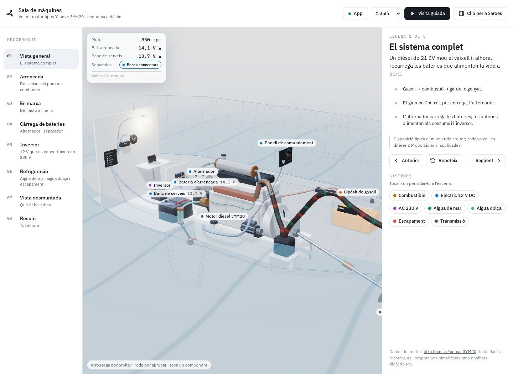
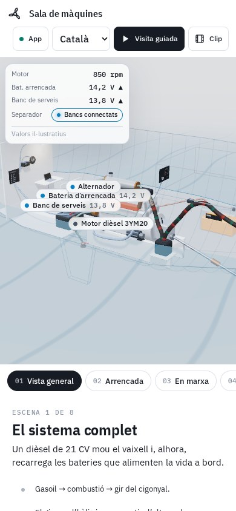

# Sala de màquines · 3YM20

Explora en 3D el funcionament de la sala de màquines d’un veler.

**[Obre el PWA / Open app](https://guirigall.github.io/MotorMarino/)** · [Guia completa](docs/guia-completa.md) · [Incidències](https://github.com/Guirigall/MotorMarino/issues)

[Català](#ca) · [Español](#es) · [English](#en)



<details>
<summary>Vista en mòbil / Mobile view</summary>



</details>

<a id="ca"></a>

## Català

Explora en 3D el funcionament de la sala de màquines d’un veler.

### Què hi trobaràs

- Vuit escenes amb recorregut guiat.
- Fitxes de components, indicadors i animacions.
- Mode de clip per explorar el conjunt.
- Interfície en català, espanyol i anglès.

### Comença

Tria una escena, segueix el recorregut i toca els components per consultar-ne les fitxes. El menú App mostra la preparació per treballar sense connexió.

### Instal·lació

Obre l’aplicació amb HTTPS. A Android, fes servir Chrome → ⋮ → **Instal·la l’aplicació** o **Afegeix a la pantalla d’inici**. A iPhone: Safari → Compartir → **Afegeix a la pantalla d’inici**. Espera la confirmació de preparació sense connexió abans d’utilitzar el mode avió. No cal APK ni sideloading.

### Dades i límits

Necessita WebGL. La primera càrrega descarrega Three.js i les fonts; espera la confirmació del mode sense connexió. És un model didàctic, no el manual de manteniment del motor.

<a id="es"></a>

## Español

Explora en 3D el funcionamiento de la sala de máquinas de un velero.

### Qué ofrece

- Ocho escenas con recorrido guiado.
- Fichas de componentes, indicadores y animaciones.
- Modo de corte para explorar el conjunto.
- Interfaz en catalán, español e inglés.

### Primeros pasos

Elige una escena, sigue el recorrido y toca los componentes para consultar sus fichas. El menú App indica cuándo está preparado el uso sin conexión.

### Instalación

Abre la aplicación por HTTPS. En Android: Chrome → ⋮ → **Instalar aplicación** o **Añadir a pantalla de inicio**. En iPhone: Safari → Compartir → **Añadir a pantalla de inicio**. Espera la confirmación de disponibilidad sin conexión antes de usar el modo avión. No necesita APK ni sideloading.

### Datos y límites

Necesita WebGL. La primera carga descarga Three.js y las fuentes; espera la confirmación de disponibilidad sin conexión. Es un modelo didáctico, no el manual de mantenimiento del motor.

<a id="en"></a>

## English

Explore how a sailing yacht’s engine room works in 3D.

### Features

- Eight scenes and a guided tour.
- Component details, gauges and animations.
- Clipping mode to explore the assembly.
- Catalan, Spanish and English interface.

### Getting started

Choose a scene, follow the tour and select components for details. The App menu reports when offline preparation is complete.

### Installation

Open the HTTPS app URL. On Android: Chrome → ⋮ → **Install app** or **Add to home screen**. On iPhone: Safari → Share → **Add to Home Screen**. Wait for offline readiness before using airplane mode. No APK or sideloading is required.

### Data and limitations

Requires WebGL. The first load downloads Three.js and fonts; wait for offline readiness. This is an educational model, not an engine maintenance manual.

## Desenvolupament / Development

Des de la carpeta del repositori, amb Python 3 / From the repository folder, with Python 3:

```bash
python3 -m http.server 8080 --bind 127.0.0.1
```

Obre / Open `http://localhost:8080/`. Per instal·lar-lo des del mòbil, utilitza l’enllaç HTTPS del PWA.

Comprovacions incloses al repositori / Checks included in this repository:

```bash
node tests-pwa.mjs
```

Les captures es generen amb Chromium a partir del codi real del repositori, en contextos sense dades personals. Es poden renovar a **Actions → Captures del README → Run workflow**. Més detalls a [la guia completa](docs/guia-completa.md).
